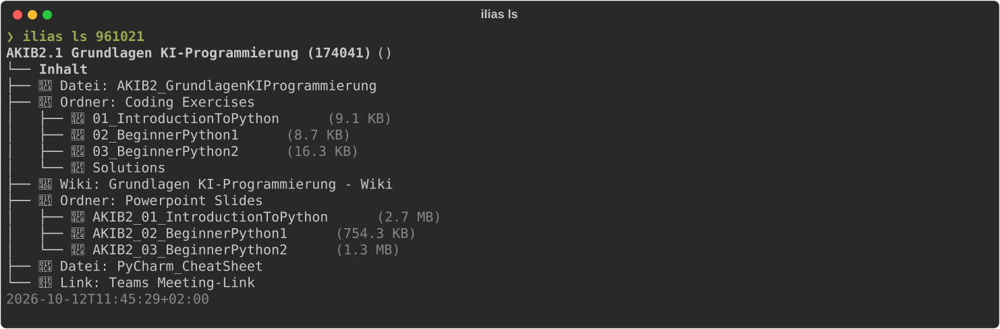
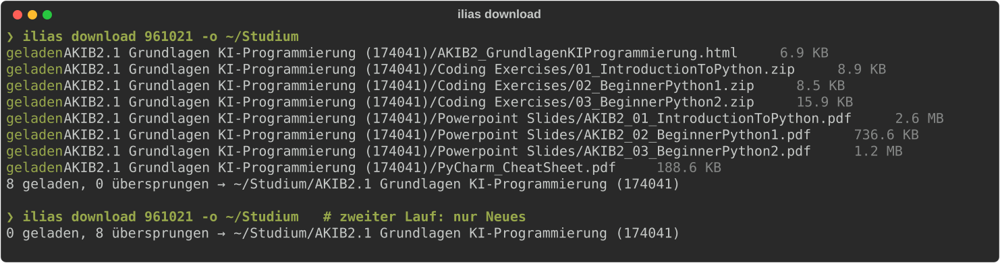

# ilias-cli

CLI (später MCP-Server) für **ILIAS** (Hochschule Heilbronn, Uni Mannheim) und **Moodle**
(Hochschule Mannheim). Anforderungen: [ANFORDERUNGEN.md](ANFORDERUNGEN.md), Vertrag:
[INTERFACE.md](INTERFACE.md), Moodle-Details: [MOODLE.md](MOODLE.md).

## Schnellstart (ILIAS HHN)

**1. Installieren** (braucht [uv](https://docs.astral.sh/uv/)):

```bash
uv tool install --force "git+https://github.com/smlfg/ilias-cli@feat/download-f5"
```

**2. Anmelden.** Benutzername ist das HHN-Kürzel, **nicht** die
Matrikelnummer. Danach Passwort und den TOTP-Code aus der Authenticator-App eingeben. Die
Session liegt im Schlüsselbund, `ilias status` prüft sie.

```bash
ilias login                      # fragt Benutzername, Passwort, TOTP
ilias login --save-password      # einmalig: merkt Benutzername + Passwort im Schlüsselbund
ilias login                      # ab dann: nur noch TOTP-Code
ilias logout --forget            # Session und gespeicherte Zugangsdaten löschen
```

Mit `--save-password` liegt das Passwort im macOS-Schlüsselbund (bzw. Secret Service/Windows
Credential Manager), nie in einer Datei. Wer an deinem entsperrten Rechner `ilias` startet,
kommt damit bis zum TOTP; geschützt bleibt der Zugang durch den zweiten Faktor. Lehnt ILIAS das gespeicherte Passwort
ab (z. B. nach Passwortwechsel), wird es gelöscht und beim nächsten Login wieder abgefragt.

**3. Kurse finden.** Die Spalte `ID` ist die ref_id des Kurses:

```bash
ilias courses
```

**4. Inhalt ansehen.** Statt der ID geht auch ein Teil des Namens, z. B. `ilias ls "KI-Programmierung"`:



**5. Herunterladen.** Pro Kurs entsteht ein Ordner. Ein zweiter Lauf lädt nur neue oder
geänderte Dateien:



Leere Ordner (z. B. noch nicht freigeschaltete Lösungen) werden übersprungen. Ordner, deren
Ansicht das Tool nicht lesen kann, erscheinen als `failed` mit Link; der Rest wird trotzdem
geladen.

## Instanzen

`ilias_core` hat ein Backend pro Plattform (`ilias_core.backends`: `IliasBackend`,
`MoodleBackend`) und eine Instanz-Registry in `ilias_core.config`. Eingebaut sind:

| `--instance` | LMS | Login | Befehle |
|---|---|---|---|
| `hhn` (Default) | ILIAS | OIDC/Keycloak (+ TOTP) | login, status, logout, courses, ls, **download** |
| `uni-mannheim` | ILIAS | SAML/Shibboleth | login, status, logout, courses, ls, download (ungetestet) |
| `hs-mannheim` | Moodle | Webservice-Token (`moodle_mobile_app`) | login, status, logout, courses, ls |

Jedes Profil lässt sich in `~/.config/ilias-cli/config.toml` (bzw.
`$ILIAS_CLI_CONFIG_DIR/config.toml`) unter `[instances.<key>]` überschreiben oder neu
anlegen (`lms = "ilias" | "moodle"`, `base_url`, bei ILIAS zusätzlich `client_id`, `auth`).
`courses`/`ls`/`download` laufen auf ILIAS (HHN getestet) und Moodle (`download` nur ILIAS).

```bash
ilias login  --instance hhn                 # ILIAS HHN
ilias login  --instance hs-mannheim         # Moodle: Benutzername + Passwort (verdeckt)
ilias status --instance hs-mannheim --json
ilias courses --instance hs-mannheim
ilias ls PR1 --instance hs-mannheim --depth 2
ilias logout --instance hs-mannheim
```

### Download (F5, nur ILIAS)

```bash
ilias download 900101 -o ~/Studium                    # ganzer Kurs -> ~/Studium/<Kursname>/<Ordner>/…
ilias download "KI-Programmierung" "Übungsblätter"    # nur ein Ordner (Pfad relativ zum Kurs)
ilias download 900101 900311                          # eine Datei per ref_id (aus `ilias ls --json`)
ilias download 900101 -n                              # --dry-run: nur anzeigen
```

- Zweiter Lauf lädt nur neue oder in ILIAS geänderte Dateien (Manifest `.ilias-download.json`
  im Kursordner). Von Hand abgelegte Dateien mit gleichem Namen werden nicht überschrieben;
  `--force` lädt trotzdem neu.
- Offline-Objekte werden übersprungen. Einzelne verweigerte Dateien stehen als `failed` in der
  Ausgabe, der Rest wird geladen, Exit-Code dann 1. Session abgelaufen -> Exit 3, Server -> Exit 4.
- `--json`: `{ok, course, target_dir, summary{downloaded,skipped,planned,failed}, items[{ref_id,name,path,status,size,error_code,message}]}`.
- Abschnitte der Kursseite („Inhalt“, Objektblöcke) werden nicht zu Ordnern, nur ILIAS-Ordner/Gruppen.

**Grenzen (bewusst einfach gehalten):** „Aktuell“ heißt: Datei liegt am Zielpfad und ILIAS-ref_id +
Änderungsdatum stimmen mit dem Manifest überein. Es gibt keinen Inhaltsvergleich (Hash):
- Kopien außerhalb des Kursordners (z. B. vorher von Hand geladen) werden nicht erkannt → doppelt auf der Platte.
- Eine von Hand an den Zielpfad gelegte Datei gilt dauerhaft als aktuell, auch wenn ILIAS neuer ist (`--force` hilft).
- Dieselbe Datei in zwei Kursen wird zweimal geladen.
- Liefert ILIAS kein Änderungsdatum, werden spätere Änderungen nicht erkannt.

## Tests

Alle Tests laufen nur gegen localhost-Fake-Server; eine Netzwerk-Sperre lässt jeden
Test scheitern, der einen echten Server erreichen will.

```bash
uv sync
uv run pytest tests/acceptance tests/attempt -q   # ILIAS (Login-Vertrag F1 + A1–A6, Unit-Tests)
uv run pytest tests/moodle -q                     # Moodle (Fake-Moodle)
uv run python tests/acceptance/leak_check.py "<geheimnis>" ~/.config/ilias-cli   # Secret-Leak-Check
```

Exit-Codes: 0 OK · 1 Auth-Fehler/sonstiges · 2 nicht eingeloggt · 3 Session abgelaufen · 4 Netzwerk/Server · 5 Parser-Fehler.
